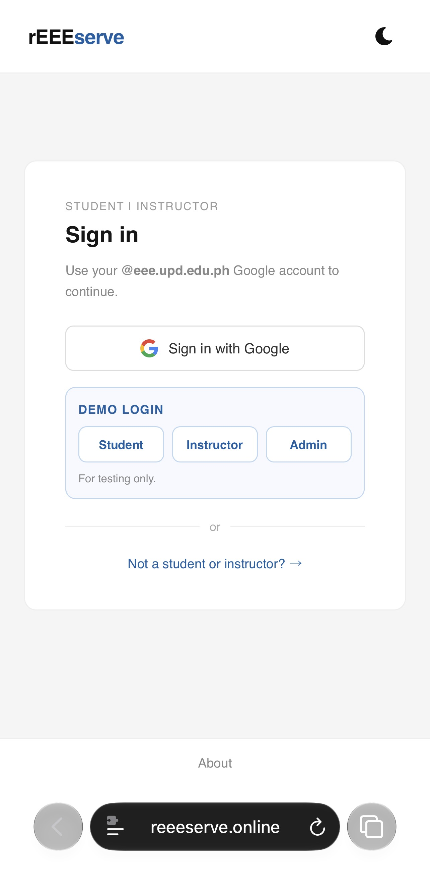
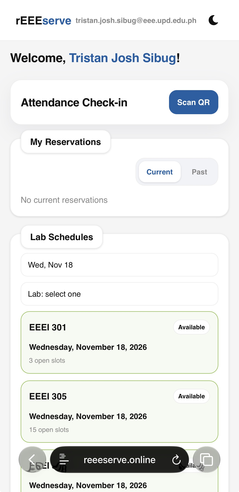
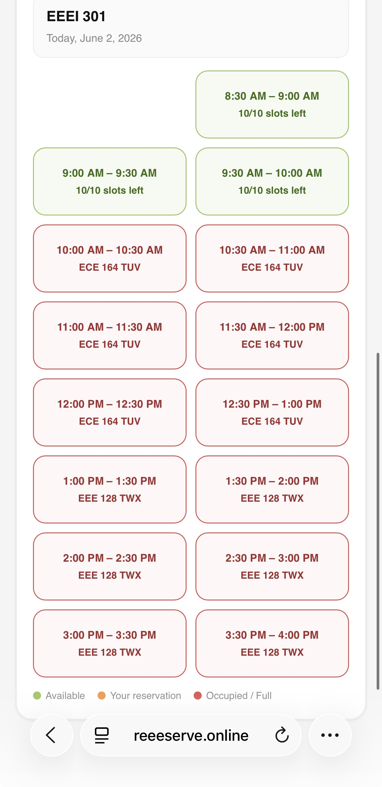
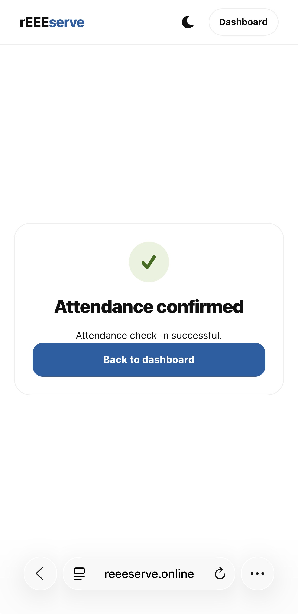
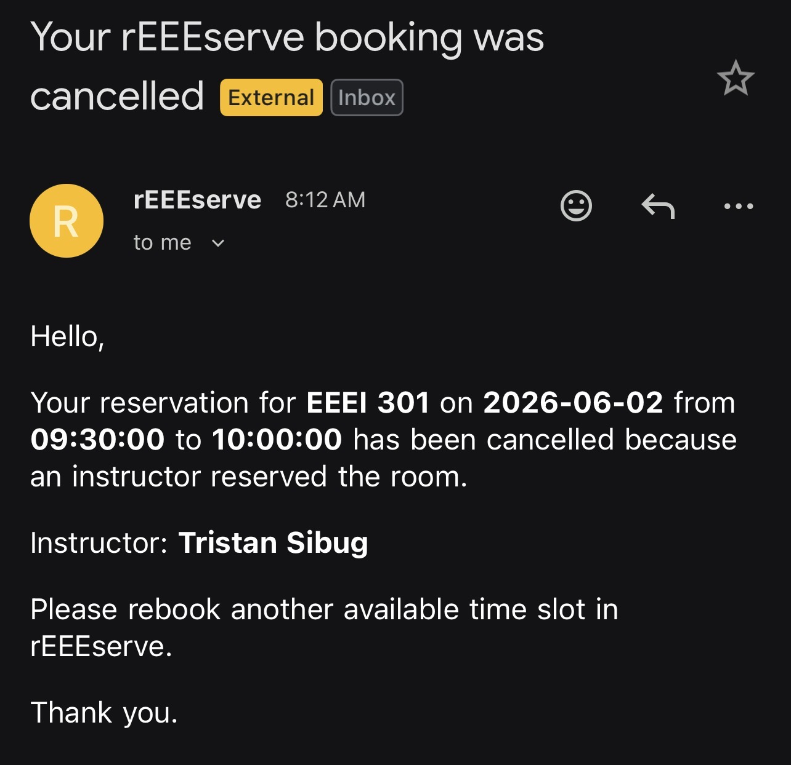
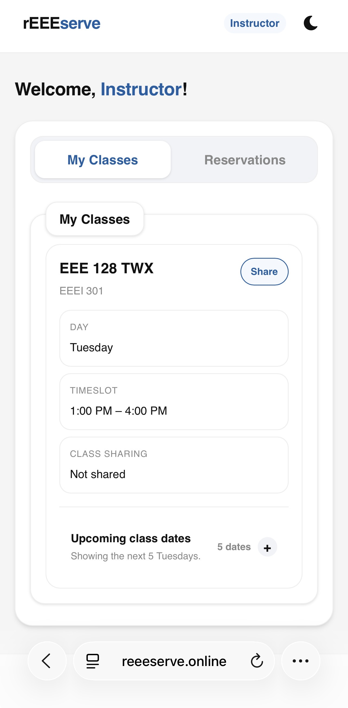
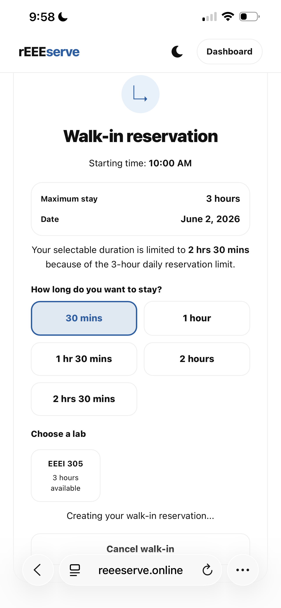
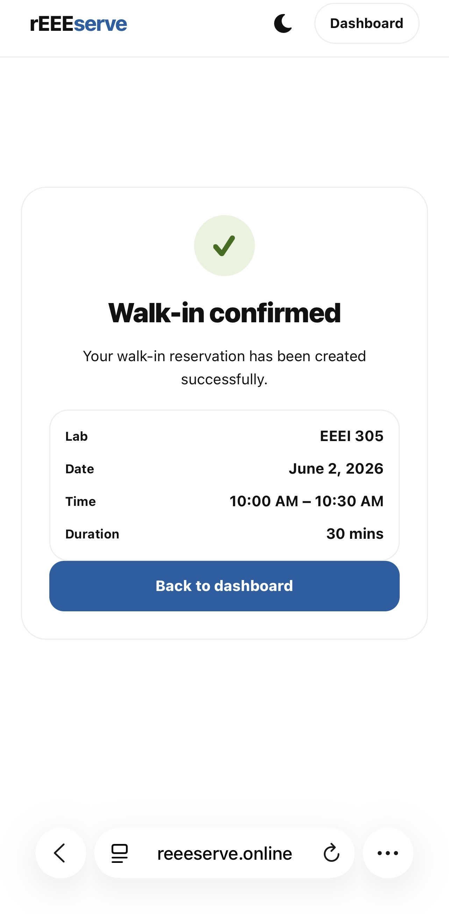
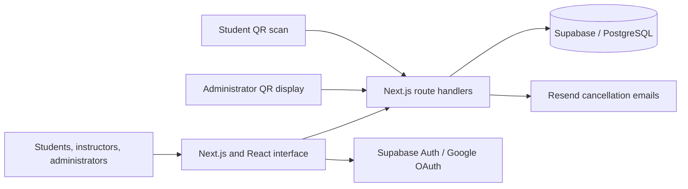

<h1 align="center">rEEEserve</h1>

<p align="center">
  <strong>Laboratory reservations, QR attendance, and walk-in access for EEEI.</strong>
</p>

<p align="center">
  <a href="https://reeeserve.online">Open the website</a> ·
  <a href="#screenshots">Screenshots</a> ·
  <a href="#how-it-works">How it works</a>
</p>

rEEEserve is a web-based laboratory reservation system designed around the workflows of the Electrical and Electronics Engineering Institute at UP Diliman. Students can check availability before travelling to campus, book a laboratory slot, and verify attendance by scanning a QR code. Instructors and administrators have their own tools for class schedules, room reservations, and facility oversight.

Co-developed by **Tristan Josh E. Sibug** and **Ruel Gregory Ordoñez** for the **Smart Systems and Emerging Technologies class** at UP Diliman. This repository contains the hosted course prototype.

## Features

| Area | What it does |
| --- | --- |
| Google sign-in | Uses Google OAuth through Supabase Auth for the EEE account sign-in flow. Instructor accounts are identified through staff records. |
| Student reservations | Shows laboratory schedules and availability, supports selecting slots, and lists current and past bookings. |
| Conflict checks | Checks weekly classes, no-class exceptions, room blocks, existing reservations, duplicate bookings, and available capacity before approving a request. |
| Instructor tools | Supports class management, no-class dates, class-sharing settings, and instructor room reservations. |
| Administrative tools | Supports creating, editing, and cancelling reservations and schedule blocks, with reservation activity records. |
| QR attendance | Generates a rotating QR code and verifies a student's approved reservation before recording attendance. |
| Walk-in access | Checks available continuous slots across laboratories and offers eligible durations for users without a reservation. |
| Cancellation emails | Notifies affected students through Resend when an instructor reservation or schedule override cancels their booking. |
| Responsive interface | Provides desktop and mobile layouts with light and dark themes. |

## Screenshots

<p align="center">
  
  
  
</p>

<p align="center"><em>Google sign-in, student dashboard, and laboratory availability</em></p>

<details>
<summary>QR attendance and cancellation email</summary>

<p align="center">
  
  
</p>

</details>

<details>
<summary>Instructor dashboard and walk-in reservations</summary>

<p align="center">
  
  
  
</p>

</details>

## How it works

### Reserve before arriving

1. Sign in through Google using the EEE account flow.
2. Browse a laboratory's schedule and choose available time slots.
3. Submit the reservation. The server checks availability and capacity against classes, room blocks, and approved bookings.
4. View the booking on the dashboard and check in when the session begins.

Availability is calculated from shared database records rather than a separate manual booking sheet. The standard student reservation route requires at least one hour of lead time; short-notice visits use the walk-in flow.

### Verify attendance with a rotating QR code

The administrator opens the [attendance QR page](app/admin/attendance/page.tsx) on a device at the laboratory. It displays a shared QR code for all laboratory rooms.

- The server generates a random token with a **30-second lifetime** and stores it in `attendance_qr_tokens`.
- The display requests a new code every **25 seconds** and shows an expiry countdown. Administrators can also generate a new code manually.
- Students use **Scan QR** from the dashboard or open the QR link with their phone. The [check-in endpoint](app/api/attendance/check-in/route.ts) validates the token, authenticated user, and approved reservation for the current Manila date.
- Check-in opens **10 minutes before** a reserved slot and remains available until that slot ends. Expired tokens and reservations outside the check-in window are rejected.
- A successful scan marks the student's continuous reservation block in the same room as checked in and writes a reservation activity record. Repeated check-in returns an already-checked-in response.

The token is not tied to a single room. The server determines the active room from the student's reservations and rejects ambiguous active bookings in different rooms.

### Find space for a walk-in

The scan flow can offer walk-in options when the student does not have an active booking. The availability service examines the supported laboratories, their classes, room blocks, existing bookings, and eligible shared class capacity.

The current configuration uses **30-minute slots**, laboratory hours of **8:00 AM to 4:00 PM**, and a **three-hour daily walk-in allowance after accounting for existing approved reservation time**. Available durations depend on continuous room availability and the student's remaining allowance. Students can select a laboratory and an eligible duration, then receive a confirmation.

Configured rooms are **EEEI 301**, **EEEI 305**, and **EEEI 308**, with capacities of **10**, **10**, and **16**, respectively. These rules are defined in the reservation and walk-in API routes.

### Handle instructor priority and notify students

An instructor reservation can displace overlapping student bookings, but the interface first asks for confirmation and reports how many bookings will be affected. Once confirmed, the system creates the instructor room block, marks affected reservations as cancelled, and records the action.

The [Resend email helper](utils/email.ts) sends the student the room, date, time, cancellation reason, and instructor name when supplied. The message asks the student to rebook another available slot. Administrative schedule overrides also use this helper.

**The email implementation in this repository sends cancellation notices.** General confirmation and reminder emails are not implemented by this helper.

## Architecture



| Layer | Technologies |
| --- | --- |
| Web application | Next.js 16, React 19, TypeScript, Tailwind CSS 4, component styles |
| Authentication and data | Supabase Auth, Google OAuth, PostgreSQL, Supabase SSR client |
| QR display and scanning | `qrcode.react`, `html5-qrcode` |
| Staff password comparison | `bcryptjs` |
| Transactional email | Resend |
| Hosting | Vercel |

The scheduling and recommendation behavior is implemented through application logic and database queries. It does not require a machine-learning model.

### Repository layout

```text
app/
  page.tsx                 Google sign-in and optional demo entry points
  dashboard/               Student reservation dashboard
  instructor/dashboard/    Instructor classes and reservations
  admin/                   Administrative dashboard and attendance QR display
  attendance/              Camera scanner and scan-result / walk-in flow
  auth/callback/           Supabase OAuth callback
  api/                     Reservation, schedule, attendance, and walk-in endpoints
utils/
  supabase/                Browser and server Supabase clients
  email.ts                 Resend cancellation-email helper
docs/screenshots/          Screenshots used in this README
```

## Project context

rEEEserve was developed as a course prototype for the **Smart Systems and Emerging Technologies class** at the University of the Philippines Diliman. The live website demonstrates the implemented workflows; it should not be read as a claim of an institute-wide operational deployment.

**Developers:** Tristan Josh E. Sibug and Ruel Gregory Ordoñez.
